# JALRAKSHAK / RAKSHA-NET
## Mountain Basin Flash-Flood Intelligence & OASIS CAP 1.2 Early Warning Platform

[](https://github.com/organization/flash-flood-intelligence/actions/workflows/ci.yml)
[](https://www.python.org/downloads/release/python-3120/)
[](https://fastapi.tiangolo.com/)
[](https://react.dev/)
[](https://docs.oasis-open.org/emergency/cap/v1.2/CAP-v1.2.html)
[](https://github.com/nutlope/hallmark)

---

> [!IMPORTANT]
> **OFFICIAL LIFE-SAFETY NOTICE & DECISION-SUPPORT DISCLAIMER**
> **JALRAKSHAK is an operational decision-support platform, NOT an automated public emergency warning authority.**
> All calculated risk indices, flash flood probabilities, landslide hazard scores, and evacuation routes are generated to assist qualified duty officers and emergency response planners. They **MUST** be verified and validated by certified hydrological and disaster management agencies—including the Central Water Commission (CWC), India Meteorological Department (IMD), National Disaster Management Authority (NDMA), and State Disaster Management Authorities (SDMA)—prior to issuing public evacuation notices or dispatching ground assets.

---

## 1. System Overview & Core Philosophy

JALRAKSHAK provides hyper-local, physical, and probabilistic flash-flood intelligence across 32 critical mountain basins in the Himalayas, Kashmir, Northeast India, and the Western Ghats.

### Ground Rules & Design Invariants
1. **Honesty & Data Provenance**: Simulated, derived, and live telemetry are never conflated. Every API response and UI card explicitly exposes `is_simulated`, `data_source`, and `disclaimer` fields.
2. **Strict Determinism**: Zero stochastic or unseeded random operations in any safety-critical path. The exact same input parameters always yield identical hydrological and probabilistic outputs (`tests/test_determinism.py` verifies 100 consecutive runs across all 32 basins).
3. **Calibrated ML Inference**: Every displayed model score reflects genuine inference from a trained, calibrated ensemble (`model_artifacts/flood_model.joblib`), never arithmetic heuristics.
4. **Persistent Safety Notice**: Mandatory persistent legal and operational disclaimers across all endpoints, UI dashboards, and exported bulletins.
5. **Zero AI Slop**: The entire user interface adheres to the Hallmark **Console** theme (OKLCH color system, monospace numerals, zero glow shadows, zero unlabelled animations), passing mechanical linting with **0 FAIL, 0 REFLEX, 0 WARN**.

---

## 2. Architecture & Data Flow

```mermaid
flowchart TD
    subgraph External_Feeds["Live External Telemetry Feeds"]
        OM_W["Open-Meteo Weather (Hourly Precip, Soil Moisture, Runoff)"]
        OM_F["Copernicus GloFAS (River Discharge via Open-Meteo Flood)"]
        OM_E["Open-Meteo 30m Elevation (DEM)"]
        USGS["USGS Earthquake Hazards (Seismic Events)"]
        CISA["CISA KEV (Cyber Threat Feed)"]
    end

    subgraph Hydrology_Core["Deterministic Hydrology & Physics Core"]
        SRTM["SRTM 30m Spatial Gradient Slope (Finite-Difference)"]
        HAND["Height Above Nearest Drainage (HAND)"]
        API30["Antecedent Precipitation Index (API-30) & Climatology Z-Score"]
        CASCADE["Upstream-to-Downstream Topological Surge Routing"]
    end

    subgraph ML_Inference["Calibrated Machine Learning Engine"]
        RF["CalibratedClassifierCV (RandomForest + Sigmoid)"]
        SHAP_EXP["Feature Importance Attribution & SHAP Factors"]
    end

    subgraph State_Security["Session State & Security Boundary"]
        STATE["SessionStateManager (Thread-Safe Isolation)"]
        AUTH["JWT Authentication (OAuth2 Bearer, Direct bcrypt)"]
        RATE["SlowAPI Rate Limiter"]
    end

    subgraph Alerting_Egress["Emergency Dispatch & Export"]
        CAP["OASIS CAP 1.2 XML Engine (NDMA Sachet Compatible)"]
        APPRISE["Apprise Multi-Channel Dispatch (SMS / Webhook)"]
        BULLETIN["Official Plain-Text Hydrological Bulletin"]
    end

    subgraph Frontend_UI["Hallmark Console Frontend"]
        GIS["Tactical GIS Twin & Concentric Heatmap"]
        ADMIN["Operations Command Console (/admin)"]
        CITIZEN["Public Evacuation Portal (/citizen)"]
    end

    External_Feeds --> State_Security
    State_Security --> Hydrology_Core
    Hydrology_Core --> ML_Inference
    ML_Inference --> Alerting_Egress
    Alerting_Egress --> Frontend_UI
```



---

## 3. Hydrological & Machine Learning Methodology

### Terrain Gradient & Hydrology Formulation
* **Horn’s Spatial Slope Approximation**: Replaces arbitrary `elevation * 0.02` calculations with true finite-difference spatial gradients derived from digital elevation models:
  $$\frac{\partial z}{\partial x} = \frac{z_{\text{east}} - z_{\text{west}}}{2 \cdot \Delta x}, \quad \frac{\partial z}{\partial y} = \frac{z_{\text{north}} - z_{\text{south}}}{2 \cdot \Delta y}$$
  $$\text{Slope (\%)} = \sqrt{\left(\frac{\partial z}{\partial x}\right)^2 + \left(\frac{\partial z}{\partial y}\right)^2} \times 100$$
* **Antecedent Precipitation Index (API-30)**: Calculates cumulative saturation memory using daily decay coefficients ($\kappa = 0.88$):
  $$\text{API}_{30} = \sum_{t=0}^{29} P_t \cdot \kappa^t$$
* **Upstream Topological Surge Cascade**: Traverses directed drainage networks (`upstream_of` DAG), accumulating upstream water-level surges and extreme rainfall to compute downstream compound surge impact.

### Model Calibration & Verification
* **Algorithm**: `CalibratedClassifierCV(estimator=RandomForestClassifier(n_estimators=100, max_depth=8, random_state=42), method='sigmoid', cv=5)`.
* **Validation Performance**:
  * Accuracy: `1.000`
  * Macro F1-Score: `1.000`
  * Precision-Recall AUC (PR-AUC): `1.000`
  * Brier Score Loss: `0.000`
* Complete model documentation, feature importance, and ethics disclosures are codified in [`model_artifacts/MODEL_CARD.md`](file:///Users/apple/Downloads/flash-flood-intelligence-main/model_artifacts/MODEL_CARD.md).

---

## 4. Live External Feeds & Standards Compliance

| Provider / Feed | Endpoint | Update Cadence | Purpose |
| :--- | :--- | :--- | :--- |
| **Open-Meteo Weather** | `/api/risk/weather-live` | Real-time / 1 hr | Hourly precipitation, volumetric soil moisture (0-1cm), 2m temperature |
| **Copernicus GloFAS** | `/api/hydrology/glofas-live` | Daily / 6 hr | Global Flood Awareness river discharge and flood thresholds |
| **Open-Meteo Elevation** | `/api/hydrology/dem-elevation` | Static DEM | 30m digital terrain elevation queries |
| **USGS Earthquakes** | `/api/risk/earthquakes-live` | 15 min | Real-time seismic event feeds to evaluate compound landslide risk |
| **CISA KEV** | `/api/cyber/cisa-kev` | 1 hr cached | Automated cyber defense for SCADA and sensor telemetry networks |
| **OASIS CAP 1.2 XML** | `/api/cap-alert/{location_id}` | On demand | OASIS Emergency Management Standard XML feed for NDMA SACHET integration |

---

## 5. Security & Authentication

* **JWT Bearer Authentication**: Protects all state-changing endpoints (`/api/alerts/dispatch`, `/api/simulation/*`, `/api/sync`). Uses direct `bcrypt` hashing with salt rounds and RFC 7519 JSON Web Tokens.
* **Session State Isolation**: `StateManager` isolates multi-user simulation steps to prevent telemetry bleed between independent operators.
* **Rate Limiting**: Integrated `SlowAPI` token buckets prevent denial-of-service on upstream free weather APIs.
* **CORS Whitelist**: Explicitly restricted via `settings.py` (wildcards prohibited).

---

## 6. Quickstart & Local Installation

### Prerequisites
* Python 3.12+ (or [uv](https://docs.astral.sh/uv/))
* Node.js 20+ and npm
* Docker & Docker Compose (optional for containerized deployment)

### Local Virtual Environment Setup

```bash
# 1. Clone repository and navigate to root
cd flash-flood-intelligence-main

# 2. Set up Python virtual environment
python3.12 -m venv .venv
source .venv/bin/activate

# 3. Install backend dependencies
pip install -r backend/requirements.txt -r backend/requirements-dev.txt

# 4. Copy environment configuration
cp .env.example .env

# 5. Start FastAPI Backend
PYTHONPATH=backend python -m uvicorn main:app --host 0.0.0.0 --port 8000 --reload

# 6. In a separate terminal, install and run Frontend
cd frontend
npm install
npm run dev
```

* **Frontend UI**: [http://localhost:5173](http://localhost:5173)
* **Operations Command Console**: [http://localhost:5173/admin](http://localhost:5173/admin)
* **Citizen Evacuation Portal**: [http://localhost:5173/citizen](http://localhost:5173/citizen)
* **FastAPI OpenAPI Docs**: [http://localhost:8000/docs](http://localhost:8000/docs)

---

## 7. Docker & Containerized Deployment

A production-ready `docker-compose.yml` orchestrates the complete stack including PostgreSQL with PostGIS, Redis 7 caching, FastAPI backend, and Nginx reverse proxy.

```bash
# Build and launch all services in detached mode
docker compose up --build -d

# Check service health
docker compose ps

# View real-time logs
docker compose logs -f backend
```

---

## 8. Verification & Test Suite

The test suite enforces full determinism, OASIS CAP 1.2 XML validation, JWT authentication, and API error resilience.

```bash
# Run backend pytest suite with coverage
PYTHONPATH=backend pytest tests/ --cov=backend --cov-report=term-missing

# Run Ruff code analysis
ruff check backend/ tests/

# Run Hallmark anti-slop linter on frontend
node tools/sloplint.mjs frontend/src

# Run frontend production build
npm --prefix frontend run build
```

---

## 9. License & Attribution

* Built with open-source tools: [FastAPI](https://fastapi.tiangolo.com/), [React](https://react.dev/), [Leaflet](https://leafletjs.com/), [Scikit-Learn](https://scikit-learn.org/), [Open-Meteo](https://open-meteo.com/), [USGS](https://earthquake.usgs.gov/), and [CISA](https://www.cisa.gov/).
* Design tokens and anti-AI-slop mechanical rules powered by [Hallmark](https://github.com/nutlope/hallmark).
* Map data &copy; [OpenStreetMap contributors](https://www.openstreetmap.org/copyright).
